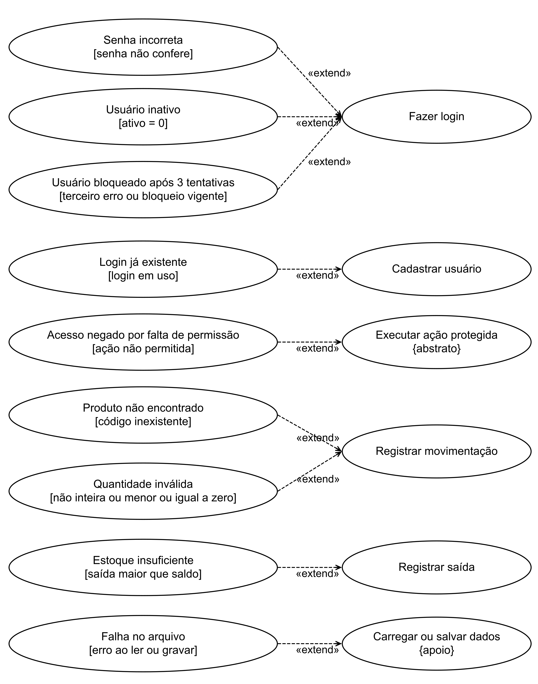
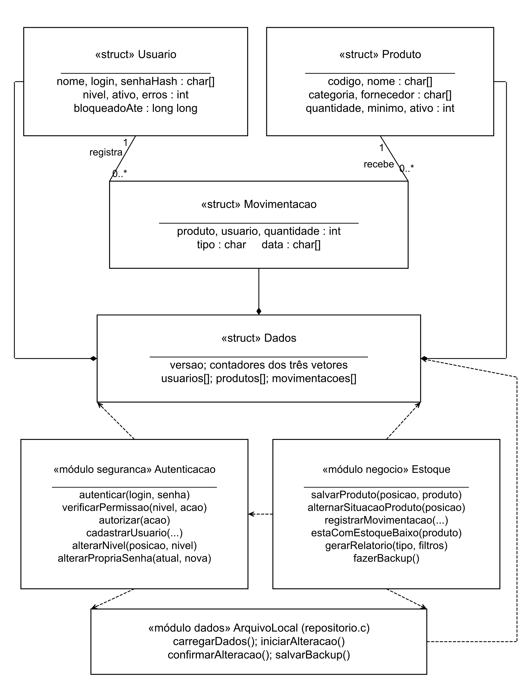
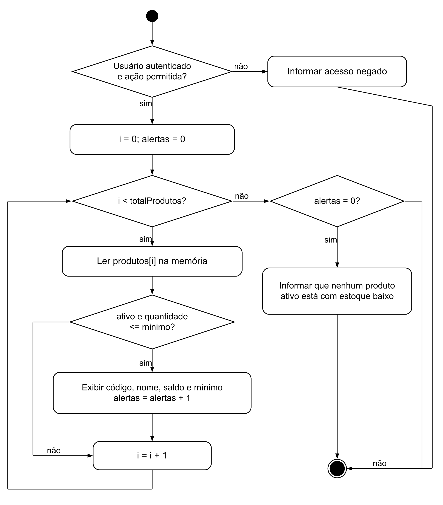
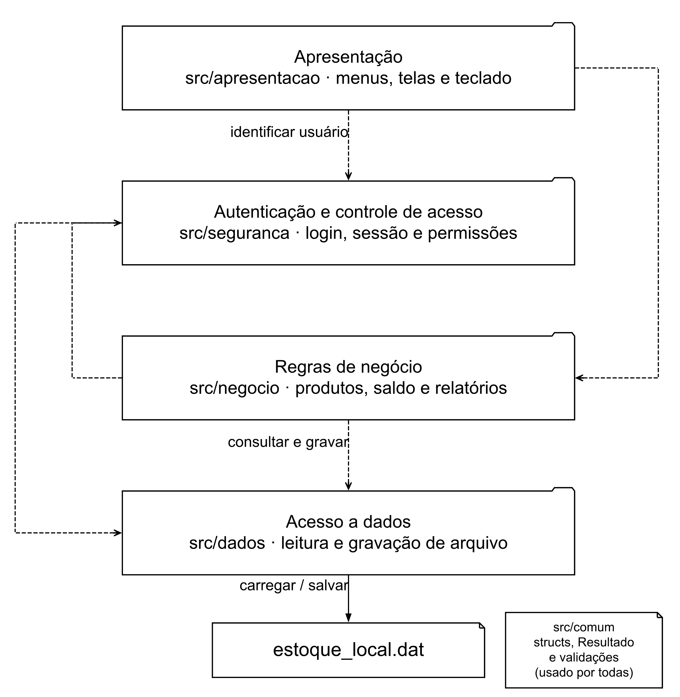
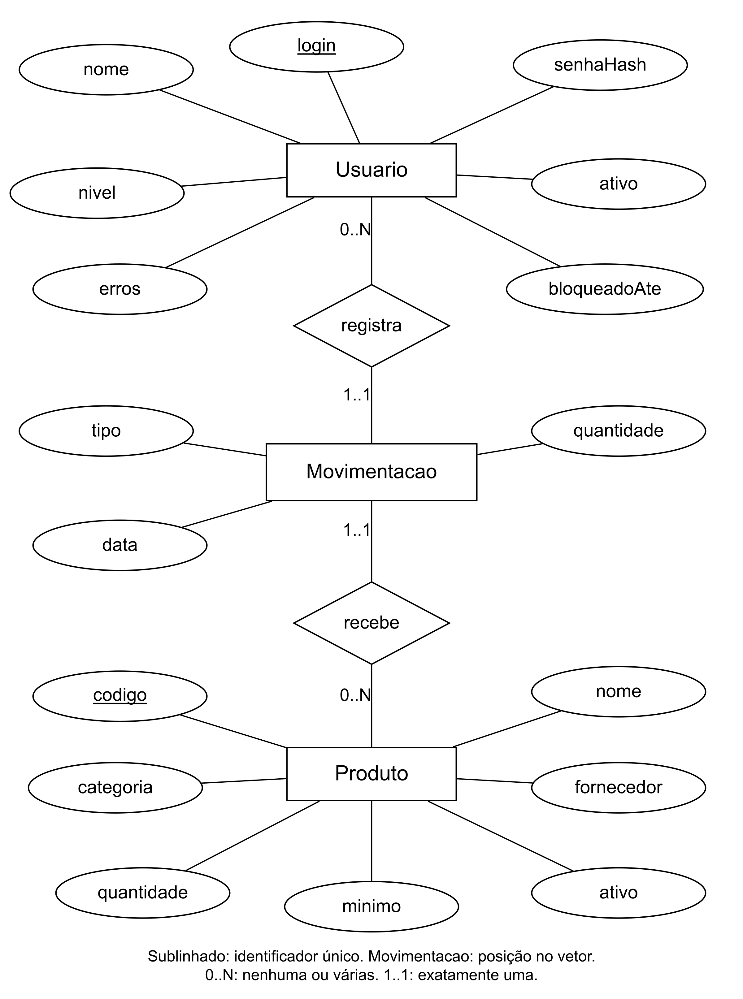
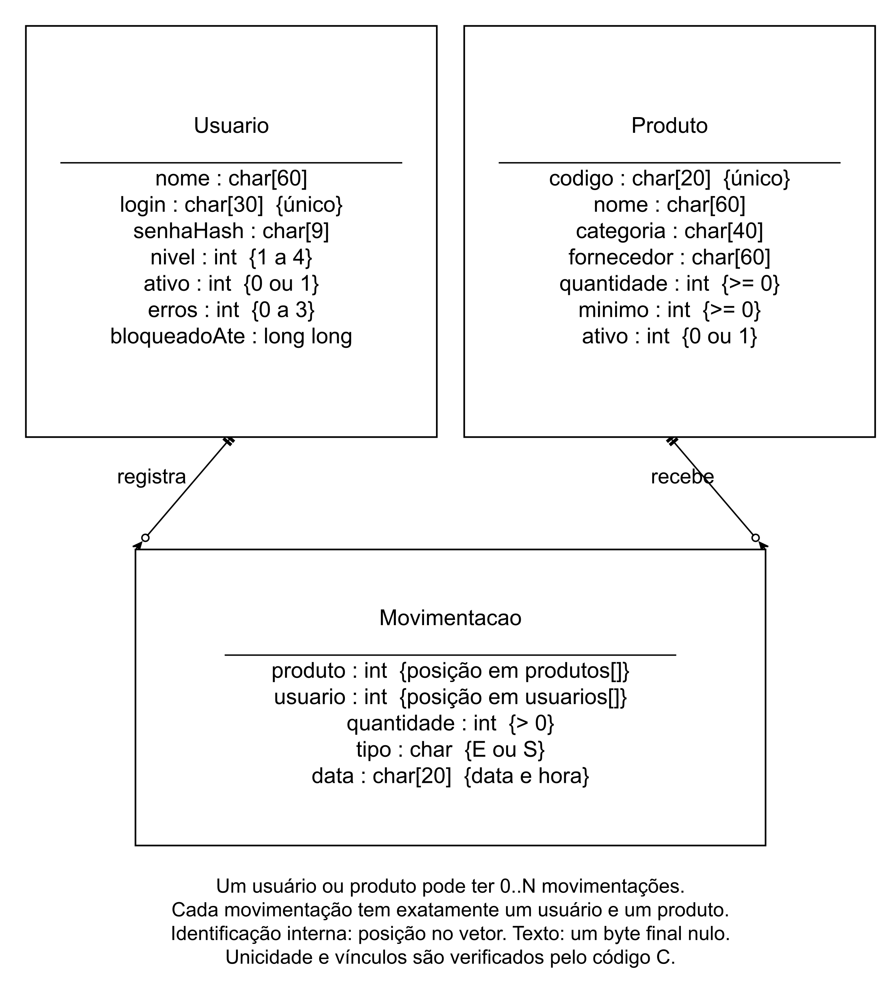

# Diagramas do EstoqueFácil

Cada desenho tem seu próprio PNG, fonte DOT e SVG. Os PNGs têm fundo branco e 2.400 pixels de largura. Clique na imagem para abrir o arquivo e ampliar.

[Caderno com os nove diagramas em Word](Caderno_de_diagramas_EstoqueFacil.docx) | [Como inserir no PIM e regenerar imagens](LEIA_ME.md) | [Conferência com o código](../docs/VERIFICACAO.md)

| Nº | Diagrama | Imagem | Fonte principal | Vetor |
|---|---|---|---|---|
| 01 | Casos de uso e permissões | [PNG](imagens/01_casos_de_uso_geral.png) | [DOT](fontes/01_casos_de_uso_geral.dot) | [SVG](vetores/01_casos_de_uso_geral.svg) |
| 02 | Casos de uso com erros | [PNG](imagens/02_casos_de_uso_erros_extend.png) | [DOT](fontes/02_casos_de_uso_erros_extend.dot) | [SVG](vetores/02_casos_de_uso_erros_extend.svg) |
| 03 | Structs e grupos de funções | [PNG](imagens/03_diagrama_classes.png) | [DOT](fontes/03_diagrama_classes.dot) | [SVG](vetores/03_diagrama_classes.svg) |
| 04 | Atividade do alerta | [PNG](imagens/04_atividades_repeticao_alerta.png) | [DOT](fontes/04_atividades_repeticao_alerta.dot) | [SVG](vetores/04_atividades_repeticao_alerta.svg) |
| 05 | Fluxograma do login | [PNG](imagens/05_fluxograma_login.png) | [DOT](fontes/05_fluxograma_login.dot) | [SVG](vetores/05_fluxograma_login.svg) |
| 06 | Pacotes e responsabilidades | [PNG](imagens/06_pacotes.png) | [DOT](fontes/06_pacotes.dot) | [SVG](vetores/06_pacotes.svg) |
| 07 | MER conceitual | [PNG](imagens/07_mer_conceitual.png) | [DOT](fontes/07_mer_conceitual.dot) | [SVG](vetores/07_mer_conceitual.svg) |
| 08 | Registros e relacionamentos | [PNG](imagens/08_der.png) | [DOT](fontes/08_der.dot) | [SVG](vetores/08_der.svg) |
| 09 | Rede da papelaria | [PNG](imagens/09_rede.png) | [DOT](fontes/09_rede.dot) | [SVG](vetores/09_rede.svg) |

Os arquivos 01, 08, 05 e 09 já estão no PIM principal, como Figuras 1, 2, 3 e 4. Os demais estão no caderno separado. Os formatos PlantUML e Mermaid disponíveis em `fontes/` são alternativas; os DOTs geraram as imagens principais.

## 01 | Casos de uso e permissões

Mostra quem pode executar cada função. Consulta e Operador partem de Usuário; Gerente reúne ambos; Administrador herda Gerente.

Fonte: elaborado pelo grupo (2026).

Fontes alternativos: [PUML](fontes/01_casos_de_uso_geral.puml).

## 02 | Casos de uso com erros

Relaciona credenciais, bloqueio, permissão, quantidade, saldo e falha no arquivo aos fluxos que podem tratar esses erros.

Fonte: elaborado pelo grupo (2026).

Fontes alternativos: [PUML](fontes/02_casos_de_uso_erros_extend.puml).

## 03 | Structs e grupos de funções

Usa a notação de classes para explicar os dados e as responsabilidades do código C, sem afirmar que C possui classes.

Fonte: elaborado pelo grupo (2026).

Fontes alternativos: [PUML](fontes/03_diagrama_classes.puml).

## 04 | Atividade do alerta

Percorre o vetor de produtos e testa ativo e quantidade menor ou igual ao mínimo.

Fonte: elaborado pelo grupo (2026).

Fontes alternativos: [PUML](fontes/04_atividades_repeticao_alerta.puml).

## 05 | Fluxograma do login

Representa as três rodadas de login, o contador por conta e o bloqueio temporário.

Fonte: elaborado pelo grupo (2026).

Fontes alternativos: [PUML](fontes/05_fluxograma_login.puml).

## 06 | Pacotes e responsabilidades

Mostra as camadas do código: apresentação, regras de negócio, autenticação e controle de acesso, e acesso a dados. Cada pacote é uma pasta de `codigo/src`.

Fonte: elaborado pelo grupo (2026).

Fontes alternativos: [PUML](fontes/06_pacotes.puml).

## 07 | MER conceitual

Representa Usuario, Produto e Movimentacao em notação de Chen, com atributos e cardinalidades.

Fonte: elaborado pelo grupo (2026).

## 08 | Registros e relacionamentos

Mostra os campos usados pelas structs e os vínculos feitos por posições nos vetores.

Fonte: elaborado pelo grupo (2026).

Fontes alternativos: [MMD](fontes/08_der.mmd).

## 09 | Rede da papelaria

Mostra a infraestrutura proposta. A versão atual roda localmente; acesso por celular e servidor central não estão implementados.

Fonte: elaborado pelo grupo (2026).

[Voltar ao início](../README.md)
