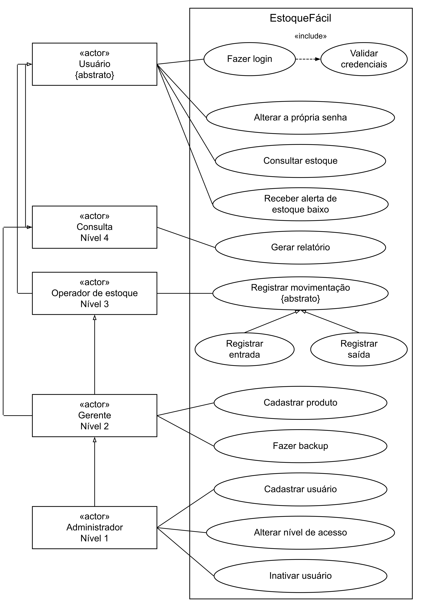

# 2.3 ENGENHARIA DE SOFTWARE ÁGIL

## 2.3.1 Regras de negócio

Regra de negócio é uma condição que o programa deve respeitar na rotina da papelaria. O grupo reuniu dez regras para o estoque, os usuários e a gravação.

RN01 - Estoque válido. O saldo é inteiro e nunca negativo. Uma saída não pode ultrapassar a quantidade disponível.

RN02 - Estoque mínimo. Todo produto tem mínimo inteiro não negativo. O alerta aparece para produto ativo com quantidade menor ou igual ao mínimo.

RN03 - Identificação única. Código do produto e login do usuário são únicos, inclusive após a inativação.

RN04 - Movimentações. Toda entrada ou saída tem produto e quantidade inteira positiva. O programa registra data, hora e usuário responsável.

RN05 - Histórico. Produto ou usuário com movimentação não pode ser apagado. O menu usa inativação também para os demais cadastros desses tipos.

RN06 - Login obrigatório. As funções exigem conta ativa e não bloqueada. A exceção é criar o primeiro usuário, obrigatoriamente Administrador, antes do primeiro login.

RN07 - Usuários. Só Administrador cadastra, inativa, reativa e muda níveis de outras contas. Pelo menos um Administrador deve permanecer ativo.

RN08 - Permissões. Cada nível acessa apenas as ações do Quadro 3. Todos podem trocar a própria senha, confirmando a atual.

RN09 - Bloqueio. Três erros consecutivos de senha de uma conta ativa bloqueiam o login por cinco minutos. Contador e prazo ficam salvos entre execuções.

RN10 - Gravação conjunta. Saldo e movimentação são confirmados juntos. Se a gravação falhar, a alteração inteira é desfeita.

Um lançamento incorreto é corrigido por outra movimentação, mantendo o histórico. O responsável anota o motivo fora do programa, pois não há campo de observação.

## 2.3.2 Requisitos funcionais

Requisito funcional descreve uma ação, como registrar as canetas recebidas. São cinco requisitos, com até três tarefas.

RF01 - Cadastro e login de usuários com níveis de acesso. Identificar quem entrou e controlar as ações.

1. Criar o primeiro Administrador e permitir que ele mantenha as demais contas e níveis.
2. Validar login e senha e tratar usuário inativo, senha incorreta e bloqueio temporário.
3. Permitir alteração da própria senha e conferir permissões nos menus e nas funções.

RF02 - Cadastrar e manter produtos. Guardar código, nome, categoria, fornecedor principal e mínimo.

1. Cadastrar produtos, informando nome, categoria e fornecedor principal.
2. Alterar dados cadastrais e estoque mínimo, sem editar diretamente o saldo.
3. Inativar ou reativar produtos, mantendo o histórico.

RF03 - Registrar entradas e saídas. Atualizar o estoque quando mercadorias chegam ou saem.

1. Localizar um produto ativo e receber o tipo e a quantidade da movimentação.
2. Conferir permissão, quantidade e saldo disponível antes da confirmação.
3. Gravar a movimentação e o saldo juntos, incluindo o usuário responsável.

RF04 - Alerta de estoque baixo. Mostrar produtos ativos que precisam de reposição.

1. Percorrer os produtos e comparar quantidade com estoque mínimo.
2. Mostrar código, nome, saldo e mínimo dos produtos em alerta.
3. Atualizar a verificação após login, movimentação ou mudança do mínimo e permitir consulta pelo menu.

RF05 - Consultar estoque e gerar relatório. Acompanhar produtos e histórico conforme as permissões.

1. Consultar estoque por código ou nome e histórico por produto e período.
2. Gerar os dados autorizados em relatorio.txt, um arquivo de texto que pode ser aberto para leitura.
3. Fazer backup do arquivo local, somente para Administrador e Gerente.

O backup fica associado ao RF05 e ao requisito de confiabilidade, sem criar um sexto requisito funcional.

## 2.3.3 Requisitos não funcionais

Requisito não funcional descreve uma qualidade e sua medição. Os cinco itens abaixo são critérios, não resultados já alcançados.

RNF01 - Usabilidade. Menus numerados e mensagens simples. Medição: quatro pessoas sem conhecimento técnico; meta de três registrarem entrada em até três minutos, sem ajuda. [AJUSTAR: registrar teste real, sem identificar participantes.]

RNF02 - Desempenho. Medir dez consultas com mil produtos, sem digitação; meta de até dois segundos por consulta. Registrar computador e tempos. A prioridade é baixa, preservando clareza e correção.

RNF03 - Segurança. Guardar só o hash, valor calculado da senha para comparação. Ocultar a digitação quando possível e conferir permissões. Medir por inspeção do arquivo e testes de login, bloqueio, conta inativa e ações proibidas.

O hash simples é didático e é uma limitação do protótipo. Um sistema real precisa de algoritmos próprios para senhas, como Argon2id ou bcrypt, com salt, um valor aleatório individual. A OWASP ([s. d.]) orienta essas medidas. O exercício não oferece essa proteção de produção.

RNF04 - Confiabilidade. Preservar os registros confirmados e não deixar saldo sem movimentação. Medir por reabertura do arquivo, erro provocado na gravação e restauração do backup em pasta separada.

RNF05 - Compatibilidade. Funcionar em macOS e Windows, sem internet. Medir pela compilação com avisos habilitados e pelo mesmo roteiro nos dois sistemas. No Mac, usar clang sem biblioteca de banco. Registrar como não testado o ambiente ainda não executado.

## 2.3.4 Quadro de permissões e casos de uso

Caso de uso descreve uma interação para atingir um objetivo. O ator representa quem usa o sistema. Aqui, os atores correspondem aos níveis de acesso da papelaria.

Quadro 3 - Permissões por funcionalidade

| Funcionalidade | Administrador | Gerente | Operador | Consulta |
|---|---|---|---|---|
| Fazer login e alterar a própria senha | Sim | Sim | Sim | Sim |
| Consultar estoque e visualizar alertas | Sim | Sim | Sim | Sim |
| Consultar histórico e gerar ou exportar relatórios | Sim | Sim | Não | Sim |
| Registrar entrada ou saída | Sim | Sim | Sim | Não |
| Cadastrar, editar e inativar produtos | Sim | Sim | Não | Não |
| Informar categoria e fornecedor no produto | Sim | Sim | Não | Não |
| Fazer backup | Sim | Sim | Não | Não |
| Cadastrar, alterar nível e inativar usuários | Sim | Não | Não | Não |

Fonte: elaborado pelo grupo (2026).

Consulta pode trocar sua senha, sem administrar contas. Não pode fazer backup, pois a cópia completa inclui dados que não aparecem nos relatórios.

A Figura 1 reúne os casos de uso. UML é uma linguagem para representar sistemas. Na generalização, um ator herda interações de outro (Object Management Group, 2017).

Figura 1 - Casos de uso e permissões do EstoqueFácil

Fonte: elaborado pelo grupo (2026).

Consulta e Operador têm o ator comum Usuário, sem herdar um do outro. Gerente reúne ambos; Administrador herda Gerente. Assim, Operador continua sem relatórios.

Fazer login inclui Validar credenciais. Entrada e Saída especializam Registrar movimentação. Os diagramas complementares ficam no caderno separado.

## 2.3.5 Descrição textual dos casos de uso

Pré-condição é o que se exige antes da ação. Principal é o caminho esperado; alternativa é outra escolha; exceção impede a conclusão. Nos casos de negócio, sessão válida e permissão do Quadro 3 são pré-condições comuns. Falhas geram mensagens sem dados sensíveis.

CU01 - Fazer login. Ator: Usuário. Pré-condição: dados locais carregados e Administrador cadastrado. Principal: informar login e senha; executar CU02; abrir menu autorizado e alertas. Alternativa: cancelar. Exceções: credenciais inválidas, conta inativa, bloqueio ou falha no arquivo. O diálogo permite até três tentativas; o bloqueio permanece associado à conta.

CU02 - Validar credenciais. Ator: Usuário, por CU01. Pré-condição: login e senha recebidos. Principal: buscar conta; conferir atividade e bloqueio; comparar hashes; zerar erros após acerto. Alternativa: reiniciar contador se o bloqueio expirou. Exceções: conta inexistente, inativa, senha incorreta ou falha no arquivo. Terceiro erro de senha grava o bloqueio. Login inexistente e senha errada recebem mensagem genérica.

CU03 - Cadastrar usuário. Ator: Administrador. Pré-condição: sessão válida. Principal: informar nome, login, senha e nível; validar; salvar o hash. Alternativa: cancelar. Exceções: login repetido, nível inválido, acesso negado ou falha no arquivo. A primeira conta é criada na inicialização, com nível Administrador obrigatório.

CU04 - Alterar nível de acesso. Ator: Administrador. Pré-condição: outra conta cadastrada. Principal: localizar conta; informar nível; gravar. Alternativa: voltar antes de escolher a conta. Exceções: conta ou nível inválido, própria conta, acesso negado ou falha de gravação. A escolha do nível confirma a alteração. A própria conta permanece Administrador ativo.

CU05 - Inativar usuário. Ator: Administrador. Pré-condição: conta ativa. Principal: localizar conta; conferir restrições; confirmar; marcar ativo como zero. Alternativa: cancelar ou reativar conta inativa. Exceções: conta inexistente, própria sessão, último Administrador, acesso negado ou falha no arquivo. O histórico permanece ligado ao usuário.

CU06 - Alterar a própria senha. Ator: qualquer nível. Pré-condição: sessão válida. Principal: conferir senha atual; receber e repetir nova senha; salvar novo hash. Alternativa: cancelar. Exceções: senha atual incorreta, confirmação diferente ou falha na gravação.

CU07 - Cadastrar produto. Atores: Administrador e Gerente. Pré-condição: sessão válida. Principal: informar código, nome, categoria, fornecedor principal e mínimo; validar; gravar com saldo zero. Alternativa: cancelar. Exceções: código repetido, campo obrigatório vazio, mínimo inválido, acesso negado ou falha no arquivo. Saldo inicial entra por movimentação.

CU08 - Registrar entrada. Atores: Administrador, Gerente e Operador. Pré-condição: produto ativo. Principal: localizar produto; informar quantidade; validar; confirmar; gravar entrada e aumento do saldo juntos; verificar alerta. Alternativa: cancelar. Exceções: produto inexistente ou inativo, quantidade inválida, acesso negado ou falha no arquivo.

CU09 - Registrar saída. Atores: Administrador, Gerente e Operador. Pré-condição: produto ativo. Principal: localizar produto; validar quantidade e saldo; confirmar; gravar saída e redução do saldo juntos; verificar alerta. Alternativa: cancelar. Exceções: produto inexistente ou inativo, quantidade inválida, estoque insuficiente, acesso negado ou falha no arquivo. A falha desfaz a operação inteira.

Na falha de gravação, o programa recupera o saldo e o histórico anteriores e informa que a operação não foi salva.

CU10 - Receber alerta de estoque baixo. Atores: todos os níveis. Pré-condição: sessão válida. Principal: percorrer produtos ativos e mostrar aqueles com quantidade menor ou igual ao mínimo. Alternativa: informar ausência de alertas. Exceção: dados locais inválidos impedem a inicialização do programa; a ausência de dados válidos não pode ser apresentada como estoque normal.

CU11 - Consultar estoque. Atores: todos os níveis. Pré-condição: sessão válida. Principal: listar ou buscar por código ou nome; mostrar saldo, mínimo e situação. Alternativa: consultar produto inativo para conferência. Exceção: produto não encontrado. A consulta usa os registros já carregados na memória.

CU12 - Gerar relatório. Atores: Administrador, Gerente e Consulta. Pré-condição: permissão para relatórios. Principal: escolher estoque ou histórico; filtrar produto e período quando aplicável; confirmar; gravar relatorio.txt e informar o nome do arquivo. Alternativa: cancelar ou gerar relatório sem registros no filtro. Exceções: período inválido, acesso negado ou falha ao gravar o relatório. Senhas e hashes não aparecem.

CU13 - Fazer backup. Atores: Administrador e Gerente. Pré-condição: destino local gravável. Principal: confirmar a gravação de backup_local.dat, que substitui a cópia anterior; salvar o conjunto completo e informar o sucesso. Alternativa: cancelar antes de iniciar. Exceções: acesso negado, falta de espaço, destino sem permissão ou falha na cópia. A recuperação será testada em outra pasta, preservando os dados em uso.

## 2.3.6 Tratamento de erros nos diagramas

No caderno, extend indica uma extensão por erro. Estoque insuficiente estende Registrar saída quando a quantidade ultrapassa o saldo. A seta parte do erro.

Os nove erros são senha incorreta, usuário inativo, bloqueio após três tentativas, login já existente, acesso negado, produto não encontrado, quantidade inválida, estoque insuficiente e falha no arquivo. A última ocorre na leitura ou gravação; consultas usam a memória.

## 2.3.7 Classes, atividades e arquitetura

O diagrama de classes agrupa dados e operações. Em C, Usuario, Produto, Movimentacao e Dados são structs, estruturas que reúnem campos. Autenticacao, Estoque e ArquivoLocal representam grupos de funções, não classes da linguagem.

Um vetor guarda registros do mesmo tipo, como fichas. A posição identifica a conta ou o produto. verificarPermissao(nivel, acao) confere as ações. Os desenhos usam os nomes do código, como minimo e registrarMovimentacao.

O diagrama de atividades representa um laço: ler o próximo produto ativo, comparar saldo e mínimo, mostrar o alerta se necessário e repetir até o fim do vetor de produtos. É como conferir as prateleiras uma por uma.

A interface lê escolhas. Autenticação e controle de acesso conferem identidade e permissão. Regras de negócio validam operações. Acesso a dados carrega e grava estoque_local.dat. Essas camadas representam responsabilidades das funções reunidas no mesmo arquivo C.

Os pacotes mostram essas responsabilidades dentro do mesmo programa.

## 2.3.8 Organização do trabalho com Scrum

Scrum organiza o trabalho em ciclos curtos com objetivo e revisão. O Product Owner cuida da ordenação do que será feito; o Scrum Master ajuda o grupo a aplicar o processo; a equipe de desenvolvimento constrói e verifica as entregas. A Daily Scrum dura quinze minutos, e os resultados são inspecionados ao final de cada sprint (Schwaber; Sutherland, 2020).

Product Owner: [NOME]. Scrum Master: [NOME]. Desenvolvimento: [NOMES]. Esses papéis do grupo não concedem permissões no programa. A meta do produto é permitir consulta confiável do saldo e da necessidade de reposição.

## 2.3.9 Backlog do produto e definição de pronto

Backlog é a lista ordenada do trabalho. A história de usuário explica uma necessidade de quem usará o sistema. Pontos comparam esforço relativo, não horas. Prior. indica prioridade. As estimativas abaixo são propostas [AJUSTAR].

Quadro 4 - Backlog do produto

| Item | História de usuário | Prior. | Pontos | Critério de aceite |
|---|---|---|---:|---|
| H01 | Como dono do MEI, quero entrar com minha conta, para proteger o acesso ao estoque. | Alta | 5 | Login correto abre o menu; terceiro erro bloqueia a conta. |
| H02 | Como dono do MEI, quero definir níveis, para limitar o que cada pessoa faz. | Alta | 5 | Administrador mantém contas; demais níveis têm a ação recusada. |
| H03 | Como usuário, quero trocar minha senha, para manter o controle da minha conta. | Média | 2 | Exige senha atual e confirmação da nova. |
| H04 | Como gerente, quero cadastrar produtos, para organizar o que a loja vende. | Alta | 3 | Código único; mínimo válido; saldo inicial zero. |
| H05 | Como operador, quero registrar entradas, para atualizar a quantidade recebida. | Alta | 3 | Saldo e histórico aumentam juntos. |
| H06 | Como operador, quero registrar saídas, para acompanhar a retirada de produtos. | Alta | 5 | Saída acima do saldo é recusada. |
| H07 | Como dono do MEI, quero ver alertas, para decidir o que repor. | Alta | 3 | Aparece abaixo e no mínimo; desaparece acima dele. |
| H08 | Como operador, quero buscar um produto, para informar sua disponibilidade. | Alta | 2 | Busca por código ou nome mostra o saldo correto. |
| H09 | Como contadora, quero consultar e exportar o histórico, para conferir movimentações. | Média | 3 | Filtros por produto e período funcionam; Operador não acessa. |
| H10 | Como dono do MEI, quero fazer backup, para recuperar os dados se houver perda. | Média | 3 | Cópia abre em teste; só Administrador e Gerente executam. |

Fonte: elaborado pelo grupo (2026). [AJUSTAR: confirmar prioridades e estimativas com o grupo.]

Pronto exige mensagem clara, permissão, teste principal e de falha, compilação sem avisos e documentação correspondente. Para texto, exige fonte e requisitos conferidos.

Pesquisa e modelagem também ocupam sprints. Trata-se de práticas do Scrum adaptadas ao PIM, sem afirmar que toda semana gerou software utilizável.

## 2.3.10 Planejamento das dez sprints

A sequência amplia o planejamento preliminar para dez semanas, de terça a segunda, entre 01/09 e 09/11/2026. [AJUSTAR: confirmar com o grupo; as datas não comprovam execução.]

Sprint backlog reúne as tarefas da semana. Cada linha acrescenta uma verificação à definição de pronto.

Quadro 5 - Objetivos, tarefas e conclusão prevista por sprint

| Sprint e período | Objetivo | Sprint backlog | Verificação para considerar pronto |
|---|---|---|---|
| 1: 01/09 a 07/09 | Entender o negócio e o problema | Descrever a papelaria; mapear entrada, saída e reposição; iniciar pesquisa bibliográfica. | Cenário e problema revisados; fontes identificadas; exemplos separados de pesquisa real. |
| 2: 08/09 a 14/09 | Definir escopo e requisitos | Revisar dez RN, cinco RF e cinco RNF; definir C e arquivo local; ordenar H01 a H10. | Requisitos e permissões coerentes; prioridades e estimativas discutidas. |
| 3: 15/09 a 21/09 | Representar o funcionamento | Elaborar casos de uso, classes, atividade do alerta e pacotes; conferir erros e permissões. | Diagramas concordam com requisitos; Operador não herda relatórios. |
| 4: 22/09 a 28/09 | Organizar e gravar os dados | Criar MER, DER e dicionário; relacionar campos às structs; testar leitura e gravação local. | Campos e vínculos conferidos; arquivo abre novamente com os registros. |
| 5: 29/09 a 05/10 | Implementar acesso e cadastro | Concluir login, níveis e troca de senha antes de produtos; criar menus numerados. | Login e bloqueio testados; permissões aplicadas; código de produto único. |
| 6: 06/10 a 12/10 | Conferir movimentações e saldo | Revisar entradas, saídas e busca; testar saldo, histórico, gravação conjunta e reabertura. | Entrada funciona; saída excessiva falha sem alterar saldo nem histórico. |
| 7: 13/10 a 19/10 | Revisar alertas e relatórios | Conferir limite do alerta; testar filtros por produto e período; revisar exportação TXT. | Alerta inclui igualdade; filtros conferidos; Operador sem relatório. |
| 8: 20/10 a 26/10 | Revisar backup, rede e privacidade | Testar cópia e recuperação; revisar rede proposta, permissões, coleta mínima e limitações. | Backup recupera em pasta de teste; rede local e evolução distribuída diferenciadas. |
| 9: 27/10 a 02/11 | Integrar e repetir o roteiro | Executar roteiro do grupo; registrar ambiente e resultados; revisar diagramas e código-fonte. | Resultados registrados; falhas tratadas; testes não feitos marcados como pendentes. |
| 10: 03/11 a 09/11 | Revisar documentação e entrega | Revisar README, Word e links; preencher dados do grupo; validar registros e preparar entrega. | Arquivos abrem; links funcionam; pendências e limitações explícitas; versão conferida. |

Fonte: elaborado pelo grupo (2026), a partir do planejamento preliminar. [AJUSTAR]

Permissões e mensagens são consideradas desde o login. A oitava semana revisa esses cuidados no conjunto.

## 2.3.11 Dailys, revisão, retrospectiva e Kanban

O grupo adotou um acompanhamento de quinze minutos por semana, com três perguntas: o que fiz, o que vou fazer e o que me trava. Chamado aqui de daily semanal, é uma adaptação acadêmica: a Daily Scrum do guia ocorre a cada dia de trabalho. Sem atas, os registros são modelos [AJUSTAR]. As dez fichas ficam no repositório; abaixo estão alguns exemplos. Semanas futuras são planejamento, não reuniões realizadas.

Quadro 6 - Modelos de registros de daily

| Sprint | O que fiz | O que vou fazer | O que me trava |
|---|---|---|---|
| 2 | Revisei as regras de estoque. | Conferir o quadro de permissões. | Os horários de trabalho dos integrantes não coincidem. |
| 4 | Descrevi os campos dos registros. | Testar a abertura pelo programa. | O arquivo não abre; preciso conferir a pasta em que o programa foi executado. |
| 5 | Li um exemplo de login em C. | Passar a struct Usuario para a função. | Ainda tenho dúvida sobre ponteiros e endereço de memória. |
| 7, prevista | Conferir dados de demonstração. | Testar saldo abaixo, igual e acima do mínimo. | Risco previsto: esquecer o caso igual ao mínimo. |

Fonte: elaborado pelo grupo (2026). Todos os registros são modelos [AJUSTAR].

A review é a revisão do que foi entregue. A retrospectiva olha a forma de trabalhar e o que pode melhorar. O quadro seguinte oferece um roteiro curto para as duas conversas.

Quadro 7 - Modelos de review, retrospectiva e lição aprendida

| Sprint | Review a registrar | Retrospectiva e lição a confirmar |
|---|---|---|
| 1 | Conferir o cenário da papelaria. | Delimitar o problema evita funções sem relação com o estoque. |
| 2 | Conferir requisitos e permissões. | Um exemplo de uso ajuda a resolver dúvidas de escrita. |
| 3 | Conferir os diagramas com os casos textuais. | Herança de ator também transmite permissões. |
| 4 | Gravar dados e conferir a leitura do arquivo. | Separar erro de caminho de erro no formato do arquivo facilita a investigação. |
| 5 | Demonstrar login e cadastro. | Testar uma função pequena ajuda a entender ponteiros. |
| 6 | Conferir entradas e saídas. | Testar só o caminho correto deixa falhas de saldo sem análise. |
| 7 | Conferir alerta e relatório. | O valor igual ao mínimo também precisa de teste. |
| 8 | Conferir backup, rede e privacidade. | Uma cópia precisa passar pelo teste de recuperação. |
| 9 | Registrar os resultados da integração. | Documentar enquanto se testa reduz esquecimentos. |
| 10 | Conferir Word, README e registros. | Texto, diagramas e código precisam da mesma revisão. |

Fonte: elaborado pelo grupo (2026). Todos os registros são modelos [AJUSTAR].

Kanban acompanha tarefas em cartões. Fazendo tem limite de dois itens. Impedimentos são anotados; o cartão chega a Feito após cumprir a definição de pronto.

Quadro 8 - Exemplo do quadro Kanban durante a sprint 5

| Backlog | A fazer | Fazendo, limite 2 | Revisão e Teste | Feito |
|---|---|---|---|---|
| H07: alerta de estoque | H04: cadastrar produto | H01: conferir login | H02: testar permissões | Definir structs |
| H09: histórico em TXT | Preparar dados de teste | H03: trocar senha | Testar login duplicado | Revisar DER |

Fonte: elaborado pelo grupo (2026). Exemplo ilustrativo [AJUSTAR].

Scrum dá o ritmo semanal, e Kanban mostra o fluxo no dia a dia.

Ligação com as outras matérias: requisitos orientam os registros e as funções em C. A pesquisa justifica escolhas; permissões e mensagens apoiam Direitos Humanos; o backup liga o programa à infraestrutura.

[Índice do trabalho](README.md) | [Referências](referencias.md)
