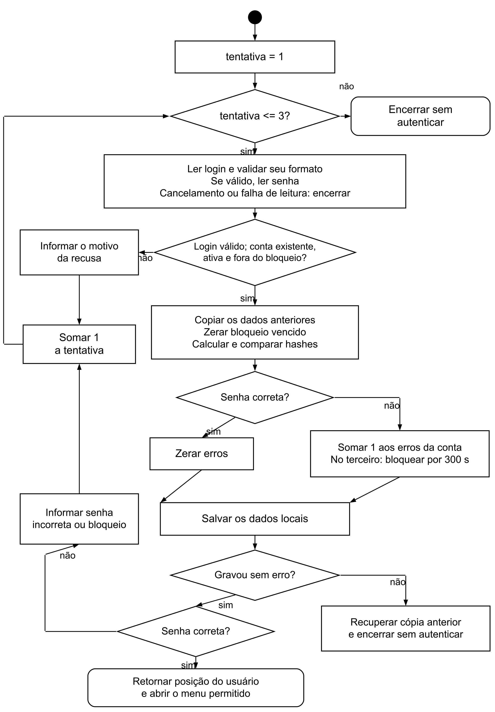

# 2.5 PROGRAMAÇÃO ESTRUTURADA EM C

## 2.5.1 Organização do programa e dos registros

O EstoqueFácil foi organizado em um arquivo chamado estoquefacil.c. As funções separam tarefas como ler o teclado, validar o login, cadastrar produtos e salvar os registros. Uma função é um trecho que realiza uma tarefa e pode ser chamado em diferentes momentos. Na papelaria, registrarMovimentacao atende tanto ao recebimento de canetas quanto à saída dessas unidades.

A estrutura, escrita com a palavra struct, reúne informações de um mesmo registro, conforme a definição da linguagem C (ISO/IEC, 2011). Usuario guarda os dados de uma conta. Produto guarda código, nome, categoria, fornecedor, quantidade, mínimo e situação. Movimentacao liga uma entrada ou saída ao produto e à pessoa que a registrou. O trecho abaixo pertence ao programa entregue.

```c
typedef struct {
    char nome[60], login[30], senhaHash[TAM_HASH];
    int nivel, ativo, erros;
    long long bloqueadoAte;
} Usuario;
```

Os vetores de char guardam texto; int guarda números inteiros. bloqueadoAte registra o instante até o qual o acesso fica suspenso. TAM_HASH vale 9: oito caracteres do hash e o marcador que encerra uma sequência de caracteres em C. Hash é um valor calculado a partir da senha, usado na comparação do login.

Os registros ficam em vetores, conjuntos de posições do mesmo tipo. O vetor de produtos funciona como uma sequência de fichas da papelaria. A estrutura Dados reúne esses vetores e seus contadores. Os limites são 50 usuários, 1.000 produtos e 10.000 movimentações. Foram escolhidos para o exercício, sem estudo de capacidade de uma loja real.

## 2.5.2 Algoritmo geral

Pseudocódigo é uma descrição das etapas antes dos detalhes da linguagem. O caminho principal do EstoqueFácil pode ser resumido assim:

```text
INÍCIO
  Carregar o arquivo local e verificar seus registros
  Se não houver usuário, cadastrar o primeiro Administrador
  Tentar fazer login em até três rodadas
  Se o login falhar, encerrar
  Exibir os produtos ativos com estoque baixo
  Repetir: mostrar opções permitidas e executar a escolhida
  Até o usuário escolher sair ou a entrada ser encerrada
FIM
```

O código completo, incluindo as verificações de erro, está disponível no [arquivo estoquefacil.c](../../codigo/estoquefacil.c), na pasta codigo do projeto, entregue separadamente.

## 2.5.3 Login e controle de acesso

A Figura 3 resume o login. fazerLogin usa um laço for, isto é, uma repetição, com até três rodadas de login e senha. Também guarda o contador de senhas erradas de cada conta ativa. No terceiro erro, a conta fica bloqueada por cinco minutos, mesmo se o programa for fechado. Acertar a senha durante o bloqueio não libera o acesso. Ao vencer o prazo, o contador é reiniciado na próxima tentativa dessa conta.

A função cadastrarUsuario cria obrigatoriamente o primeiro usuário como Administrador. Depois, apenas esse nível administra contas. Todos podem alterar a própria senha, informando a atual. verificarPermissao(nivel, acao) retorna 1 para uma ação permitida e 0 para uma ação negada. O switch seleciona o tratamento de cada número. No menu, outro switch chama a função escolhida, após conferir a permissão.

O menu exibe somente as opções autorizadas. Mesmo que Júlia digite o número de administrar usuários, sua conta de Operador recebe uma negativa. Consulta pode gerar relatórios, mas Operador não pode. Por isso, as permissões são conferidas por ação, sem supor que todo nível herda todas as funções do seguinte.

A função lerSenha desliga a exibição dos caracteres no terminal com termios.h no macOS e Linux. O código de conio.h fica apenas no bloco _WIN32, compilado no Windows. O programa restaura o terminal ao terminar a leitura e trata interrupções previstas. Se a entrada vier de arquivo ou de um teste automático, lê normalmente, sem tentar ocultar os caracteres. A ocultação na tela não protege o arquivo de dados.

## 2.5.4 Produtos, movimentações e alertas

manterProduto(0) cadastra e manterProduto(1) altera produtos. O saldo inicial é zero; as primeiras dez canetas exigem uma entrada. Alterar nome ou mínimo não muda o saldo. Categoria e fornecedor são textos do produto, conforme a seção 2.4.

registrarMovimentacao recebe 1 para entrada e 0 para saída. Confere permissão, produto ativo, quantidade e saldo. Registra data, hora e responsável junto da alteração. Recusa, por exemplo, seis canetas quando só existem cinco. O alerta usa este trecho dentro do laço:

```c
Produto *p = &dados.produtos[i];
if (p->ativo && p->quantidade <= p->minimo) {
    printf("[ESTOQUE BAIXO] %s | %s | quantidade %d | minimo %d\n",
        p->codigo, p->nome, p->quantidade, p->minimo);
    alertas++;
}
```

O ponteiro p indica a posição do produto na memória. & obtém essa posição. O saldo é acessado com p->quantidade. verificarEstoqueBaixo percorre as fichas e mostra ESTOQUE BAIXO para produto ativo no mínimo ou abaixo dele. É chamada após login, mudanças de produtos e movimentações, além da opção do menu.

## 2.5.5 Arquivos, relatórios e verificação

Persistência é conservar registros depois de fechar o programa. carregarDados usa fread para ler estoque_local.dat. salvarArquivo usa fwrite para gravar um arquivo temporário antes de substituir o principal. Na falha, guardarAlteracao recupera a cópia anterior em memória. Isso não oferece as garantias de um SGBD, discutido na seção 2.4.

gerarRelatorio grava estoque ou histórico em relatorio.txt, com filtro de código e de período no histórico. fazerBackup produz backup_local.dat. Ambos confirmam a substituição da cópia anterior. O relatório não inclui hashes; o backup guarda os registros completos.

Na verificação técnica em macOS, o clang compilou sem avisos com -Wall, -Wextra, -Wpedantic e -Werror. Foram conferidos níveis, login, bloqueio, produtos, movimentações, alertas, relatório, backup, arquivo truncado e falha de gravação. A expiração do bloqueio foi simulada nos dados de teste. Windows e Linux não foram executados. [AJUSTAR: acrescentar apenas os testes que o grupo também realizar.]

Figura 3 - Fluxo do login com até três rodadas



Fonte: elaborado pelo grupo (2026).

Ligação com as outras matérias: o código executa os requisitos e a modelagem. As permissões protegem as responsabilidades da loja, e os testes apoiam as revisões das sprints.

[Índice do trabalho](README.md) | [Referências](referencias.md)
