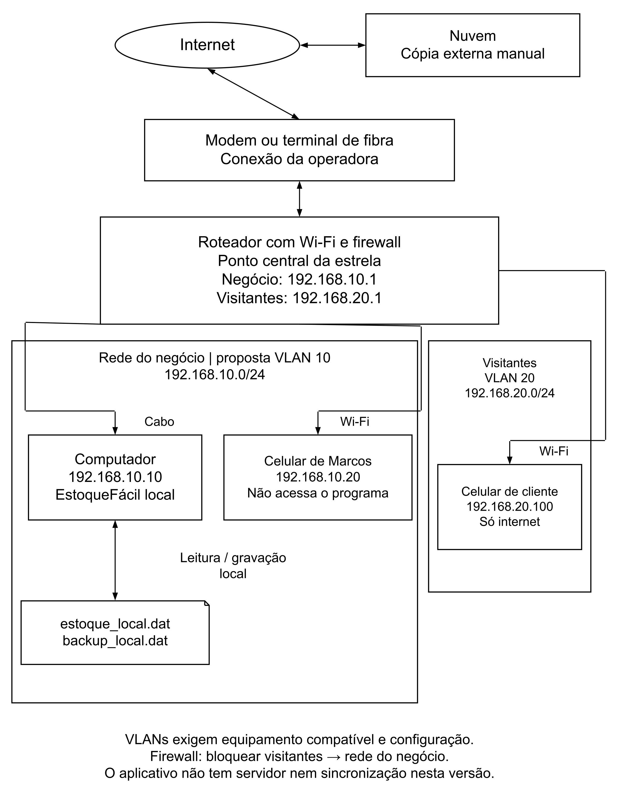

# 7 REDES DE COMPUTADORES E SISTEMAS DISTRIBUÍDOS

## 7.1 Rede proposta para a papelaria

O EstoqueFácil funciona em um computador, sem internet para login ou movimentação. A rede atende outras tarefas, como comunicação com fornecedores e envio de cópias. O celular de Marcos usa a rede, mas não acessa o programa.

A proposta reúne modem ou terminal de fibra, roteador com Wi-Fi, computador e celular. O equipamento da operadora fornece a conexão externa; o roteador conecta os dispositivos e encaminha a comunicação entre redes. Essas funções podem estar no mesmo aparelho.

Na topologia estrela, as ligações convergem para um ponto central: o roteador. O computador usa cabo e o celular, Wi-Fi. É como organizar o acesso à loja por uma porta conhecida. Se o roteador parar, o estoque local ainda funciona no computador ligado.

## 7.2 Endereçamento privado

IP identifica uma interface na rede. Os exemplos do Quadro 11 pertencem à faixa privada da RFC 1918 (Rekhter et al., 1996). São propostas, sem instalação realizada.

Quadro 11 - Exemplo de endereçamento da rede

| Equipamento ou interface | Endereço proposto | Uso |
|---|---|---|
| Roteador do negócio | 192.168.10.1 | Saída para outras redes |
| Computador do estoque | 192.168.10.10 | EstoqueFácil local |
| Celular de Marcos | 192.168.10.20 | Comunicação do negócio |
| Roteador de visitantes | 192.168.20.1 | Saída para a internet |
| Celular de visitante | 192.168.20.100 | Exemplo de endereço recebido |

Fonte: elaborado pelo grupo (2026).

A máscara 255.255.255.0, ou /24, delimita a parte que identifica cada rede. DHCP pode distribuir endereços automaticamente; uma reserva pode manter o IP do computador. Isso não é exigido pelo programa local.

## 7.3 Separação da rede do negócio e dos visitantes

A Figura 4 apresenta duas VLANs. VLAN é uma rede local virtual, separação lógica configurada em equipamentos compatíveis (Cisco, [s. d.]). A VLAN 10 atende ao negócio; a 20, aos clientes. A comparação é com balcão e fundos: visitar a loja não dá acesso aos registros internos.

O Wi-Fi de cada grupo precisa estar associado à rede correta. O firewall, que permite ou nega tráfego, deve bloquear visitantes para a rede interna. Dois nomes de Wi-Fi não comprovam isolamento. O equipamento precisa suportar e ter essa configuração; nenhuma VLAN foi instalada neste projeto.

Senhas próprias, atualizações do roteador e bloqueio de tela ajudam a proteger a infraestrutura. As permissões do EstoqueFácil não impedem copiar os arquivos diretamente pelo sistema operacional.

## 7.4 Comunicação entre serviços e backup em nuvem

As funções de C trocam dados dentro do programa e gravam no disco. Na rede, DHCP distribui endereços e DNS localiza serviços por nome. Eles não calculam o saldo.

Nuvem utiliza recursos externos pela rede. Administrador ou Gerente pode gerar backup_local.dat e copiá-lo manualmente para um serviço escolhido. Não há sincronização automática. As cópias precisam de identificação por data, acesso restrito e teste de recuperação em pasta separada.

Uma cópia no próprio computador não resolve a perda do equipamento. O .dat contém contas e hashes, não é criptografado e deve ser restaurado no mesmo ambiente. Compilar o código em dois sistemas não garante transportar o arquivo entre eles.

## 7.5 Evolução para vários dispositivos

Arquitetura distribuída divide tarefas entre computadores. Para várias lojas, clientes poderiam solicitar operações a um servidor central. Uma API, interface entre programas, receberia pedidos por conexão protegida. O servidor conferiria login, permissão e saldo.

Escalabilidade é atender ao crescimento. Seria necessário tratar acessos simultâneos e falhas de conexão, sem permitir que duas saídas usem indevidamente o mesmo saldo. Essa evolução não foi implementada. Hoje, apenas uma instância, ou execução, deve acessar o .dat por vez; duas poderiam substituir as gravações uma da outra.

Figura 4 - Rede proposta para a Papelaria Ponto do Caderno

Fonte: elaborado pelo grupo (2026).

Ligação com as outras matérias: a rede planeja as conexões da loja. C mantém o estoque local; a modelagem, as permissões e Direitos Humanos orientam as cópias e a privacidade.

[Índice do trabalho](README.md) | [Referências](referencias.md)
